## Joint Work With

::: {style="text-align: center; font-size: 1.3em; margin-top: 1em;"}
**Jialin Liu** (U. Central Florida)

**Lisang Ding** (UCLA)

**Stanley Osher** (UCLA)
:::

::: {style="text-align: center; font-size: 0.9em; margin-top: 2em;"}
Based on: *Expressive Power of Implicit Models: Rich Equilibria and Test-Time Scaling*

ICLR 2026 · arXiv:2510.03638
:::

::: notes
(about 15 s) This is joint work with Jialin Liu, Lisang Ding and Stan Osher. The core results appeared at ICLR this year. The last third of the talk connects them to recent work by many other groups.
:::

## Same Parameters, Better Answer

::: {layout-ncol=3}
{width=66%}

{width=66%}

{width=66%}
:::

Both have **32.64 M** parameters. Only one may **iterate**.

::: notes
(about 50 s) Let me start with a picture. On the left is a blurred, noisy image. In the middle and on the right are two reconstructions by two neural networks. The two networks have exactly the same number of parameters, about thirty-three million. Yet the one on the right is more than two decibels better, and you can see it in the texture. It has no extra weights. The only difference is that it is allowed to apply the same block repeatedly, until the output stops changing. So the question for today is: where does that extra power come from?

Reference: 26.97 ± 3.54 dB (explicit) vs 29.18 ± 3.66 dB (implicit HQS), both 32.64 M parameters.
:::

## One Block, Applied Repeatedly

**Explicit model:** learn $F(\mathbf{x})$ directly

**Implicit model:** learn an operator $G$ whose fixed point is the answer

$$\mathbf{y}_* = G(\mathbf{y}_*, \mathbf{x}), \qquad \mathbf{y}_t = G(\mathbf{y}_{t-1}, \mathbf{x})$$

::: {style="font-size: 0.76em;"}
- **Deep equilibrium models** [@bai2019deep]
- **Fixed-point networks** [@fung2022jfb]
- **Learned solvers:** imaging [@gilton2021deep], PDEs [@marwah2023deep]
- **Looped transformers** [@yang2024looped; @geiping2025scaling]
:::

::: notes
(about 55 s) Here is the template. An explicit model learns the map F from input to output directly. An implicit model learns an operator G, and its answer is the fixed point of G: we iterate y t equals G of y t minus one and x, with the input x injected at every step. This one template covers several families. Deep equilibrium models. Fixed-point networks, which we developed with Samy Wu Fung, Howard Heaton and others, together with a cheap way to train them. Learned solvers for inverse problems and PDEs. And looped transformers, which are the language-model version of the same idea.
:::

## The 2026 Looped Transformer Wave

::: {style="font-size: 0.66em;"}
:::: {.columns}
::: {.column width="52%"}
**In frontier-scale LLMs**

- **GPT-6 Astra** (OpenAI): *reported* to use recurrent depth [@theinformation2026astra; @kahn2026astra]
- **DeepSeek-V4.1-Flash**: looped for 8 rounds at 552B scale in an academic study [@leng2026looping]
- **Open-weight looped LLMs**: Ouro [@zhu2025ouro], Nanbeige4.2-3B
:::
::: {.column width="48%"}
**In research**

- Fixed points by design [@movahedi2026fixed; @feinashley2026solve; @huang2026equilibrium]
- Stable scaling [@prairie2026parcae]
- Theory and analysis [@labovich2026stability; @wu2026looped; @blayney2026mechanistic]
:::
::::
:::

::: {.callout-note appearance="minimal"}
Shared recipe: **one block, looped; more loops at test time, better answers**
:::

::: notes
(about 70 s) And this year, the idea reached the frontier. In September, The Information and then Fortune reported that OpenAI's GPT-6 Astra uses recurrent depth, that is, looped transformers, for part of its architecture. I should be careful: this is press reporting from unnamed sources. OpenAI has not confirmed it, and its chief scientist has said the use is limited. On the open side, DeepSeek's V4.1 model is not looped as released, but an academic team has looped it for eight rounds at five hundred billion parameters to study serving cost. And there are open-weight looped language models you can download today. On the research side, a whole group of papers now designs transformers around fixed points, scales them stably, and analyzes what the loops converge to. The recipe is shared: one block, looped, and more loops at test time give better answers.

Status check. Astra: The Information (unnamed sources) and Fortune, Sep 3 2026; not officially confirmed; OpenAI says use is limited and depth is within 2x of GPT-4. DeepSeek V4 and V4.1 as released are NOT looped; Leng et al. (UCSD, Tsinghua, Nanjing; arXiv:2611.13378) loop V4.1-Flash for 8 rounds at 552B scale. Open-weight: Ouro (2025), Nanbeige4.2-3B (arXiv:2607.22083).
:::

## The Central Mystery

::: {.r-fit-text style="text-align: center;"}
How can a **simple** operator $G$

represent a **complex** mapping $F$

just by **iterating more**?
:::

::: notes
(about 25 s) But here is what nobody has explained. The block does not grow. It is no more complex after ten loops than after one. So how can a simple operator represent a complex mapping, just by iterating more? That is the mystery, and it is the same mystery for implicit models and for looped transformers.
:::

## The Obvious Answers Fall Short

**Universality of weight-tied networks** [@bai2019deep]

- Does not guarantee that the iteration converges

. . .

**Averaging:** $G(\mathbf{y},\mathbf{x}) = (1-\eta)\,\mathbf{y} + \eta\, F(\mathbf{x})$

- Fixed point is $F(\mathbf{x})$ ✓
- But $G$ is as irregular as $F$: nothing is gained

. . .

::: {.callout-note appearance="minimal"}
**The real question:** can $G$ be *strictly simpler* than the map it computes?
:::

::: notes
(about 55 s) There are two obvious answers, and both fall short. The first is universality: a weight-tied network can copy any deep network. True, but that result does not tell you the iteration converges, so it says nothing about more loops being better. The second is averaging: take G to be a convex combination of y and F of x. That does converge to F. But F is sitting inside G. The operator is exactly as irregular as the target, so nothing is gained. So the real question is sharper: can G be strictly simpler than the map it computes?
:::

## A Simple Operator for $1/x$

Target: $F(x) = 1/x$ on $(0,1]$, the solution of $xy - 1 = 0$

. . .

**Fixed-point iteration:** $G(y,x) = y - \eta\,(xy - 1)$, with $0<\eta<1$

$$y_t - \frac{1}{x} = (1 - \eta x)\left(y_{t-1} - \frac{1}{x}\right)$$

. . .

::: {.columns}
::: {.column width="50%"}
**Target $F$:** $|dF/dx| = 1/x^2 \to \infty$

**Singular**
:::
::: {.column width="50%"}
**Operator $G$:** $|\partial G/\partial x| = \eta |y|$, $|\partial G/\partial y| = 1-\eta x$

**No singularity**
:::
:::

::: notes
(about 65 s) Here is the smallest example where the answer is yes. Take F of x equals one over x on the interval zero to one. It blows up at zero. But one over x is also the solution of x y minus one equals zero, and we can solve that equation by a fixed-point iteration: G of y and x equals y minus eta times x y minus one. Subtract one over x from both sides and you see the error contracts by a factor one minus eta x at every step. Now compare the two objects. The target has an unbounded derivative. The operator is a quadratic polynomial; its derivatives are perfectly tame. Notice one thing for later: the contraction factor, one minus eta x, depends on the input, and it tends to one as x tends to zero.
:::

## Every Iterate Is Tame; the Limit Is Not

```{python}
#| fig-align: center
#| out-width: 86%

import numpy as np
import matplotlib.pyplot as plt

plt.rcParams.update({"font.size": 15})
eta = 0.9
x = np.linspace(1e-3, 1, 2000)
ts = [1, 4, 16, 64, 256]
blues = ["#93c5fd", "#60a5fa", "#3b82f6", "#1d4ed8", "#1e3a8a"]

fig, ax = plt.subplots(figsize=(8.4, 3.6), facecolor="#fafafa")
ax.set_facecolor("#fafafa")
for t, c in zip(ts, blues):
    y = (1 - (1 - eta * x) ** t) / x
    ax.plot(x, y, color=c, linewidth=2.2, label=f"$y_{{{t}}}(x)$")
ax.plot(x, 1 / x, color="#1a1a2e", linestyle="--", linewidth=1.6, label="$1/x$")

ax.set_xlim(0, 1)
ax.set_ylim(0, 30)
ax.set_xlabel("x")
ax.spines[["top", "right"]].set_visible(False)
ax.legend(frameon=False, ncol=2, loc="upper right")
plt.tight_layout()
plt.show()
```

::: {style="font-size: 0.85em;"}
With $y_0=0$: $y_t$ is a polynomial, $\mathrm{Lip}(y_t) = \eta^2\, t(t-1)/2$. Iterations buy steepness.
:::

::: notes
(about 60 s) This plot shows what the iteration does, starting from zero. The dashed curve is one over x. The blue curves are the iterates after one, four, sixteen, sixty-four and two hundred fifty-six steps. Every blue curve is a polynomial, bounded, with a finite slope everywhere. None of them is one over x. But the family climbs toward it, and it climbs last exactly where the target is steepest. In this example you can even compute the Lipschitz constant of the t-th iterate: it grows like t squared. So iterations buy steepness. That is the whole talk in one picture.

Reference: eta = 0.9. y_t(x) = (1 - (1 - eta x)^t)/x; Lip(y_t) = eta^2 t(t-1)/2 is a short calculation for this talk, not stated in the paper.
:::

# The Theory

::: notes
(about 5 s) Let me now make this precise.
:::

## Simple vs. Complex

::: {.columns}
::: {.column width="50%"}
**Globally Lipschitz**

One constant $L$ works everywhere

→ "**Simple**"
:::
::: {.column width="50%"}
**Locally Lipschitz**

$L$ can vary by location

→ "**Complex**"
:::
:::

. . .

**Locally but not globally Lipschitz:**

$$\log x, \quad \tan x, \quad \sqrt{x}, \quad 1/x, \quad \Gamma(x)$$

All have regions of unbounded slope

::: notes
(about 35 s) We need a notion of simple and complex that does not depend on any architecture. We use Lipschitz continuity. A globally Lipschitz map has one constant that works everywhere; we call that simple. A locally Lipschitz map has a constant near every point, but the constant may grow without bound; we call that complex. The logarithm, the tangent, the square root, one over x, the gamma function: all are locally but not globally Lipschitz.
:::

## Regular Implicit Operators

::: {style="font-size: 0.9em;"}
**Definition:** $G(\mathbf{y}, \mathbf{x})$ is *regular* if:

1. **Simple in $\mathbf{x}$:** for fixed $\mathbf{y}$, $\mathbf{x} \mapsto G(\mathbf{y}, \mathbf{x})$ is globally Lipschitz, with constant growing at most linearly in $\|\mathbf{y}\|$

2. **Contractive in $\mathbf{y}$:** for fixed $\mathbf{x}$, $\mathbf{y} \mapsto G(\mathbf{y}, \mathbf{x})$ is a contraction with modulus $\mu(\mathbf{x}) < 1$
:::

. . .

::: {.callout-note appearance="minimal"}
The contraction modulus $\mu(\mathbf{x})$ **depends on the input**. It may approach 1.
:::

::: notes
(about 55 s) Now the class of operators. We call G regular if two things hold. First, it is simple in the input: for fixed y, it is globally Lipschitz in x, with a constant that may grow linearly in the norm of y. Second, it is contractive in the state: for fixed x, it is a contraction in y. By Banach's theorem there is a unique fixed point, and the iteration converges to it. The one unusual ingredient is in the box: the contraction modulus mu depends on the input. It is below one for every x, but it may approach one. In the example, mu was one minus eta x.
:::

## Theorem: Sufficiency

::: {.callout-note icon=false}
## Theorem (Sufficiency)
Let $F: X \to \mathbb{R}^n$ be **locally Lipschitz** on $X\subset \mathbb{R}^d$.

Then there exists a **regular** implicit operator $G$ such that

$$\text{Fix}(G(\cdot, \mathbf{x})) = F(\mathbf{x}) \quad \text{for all } \mathbf{x} \in X$$
:::

::: aside
$X$ need not be bounded, compact, closed, or connected
:::

. . .

**Translation:** every locally Lipschitz target is the fixed point of a simple operator

::: notes
(about 40 s) Here is the first theorem. Take any locally Lipschitz target F, on any subset of Euclidean space; the domain does not have to be bounded, closed or connected. Then there exists a regular operator G whose fixed point is F of x, for every x. In words: every complex target is the fixed point of some simple operator. So one over x was not a lucky example.

Reference: Theorem 2.4. Existence in function space; no width or parameter bound.
:::

## Theorem: Necessity

::: {.callout-note icon=false}
## Theorem (Necessity)
Let $G$ be a **regular** implicit operator.

For every $\mathbf{x}$, $G(\cdot, \mathbf{x})$ has a unique fixed point $\mathbf{y}_*(\mathbf{x})$,

and $\mathbf{x} \mapsto \mathbf{y}_*(\mathbf{x})$ is **locally Lipschitz**.
:::

. . .

::: {.callout-tip icon=false}
## A sharp boundary
Fixed-point maps of regular operators $=$ locally Lipschitz maps
:::

::: notes
(about 40 s) And the converse. If G is regular, then the fixed point is unique, and the fixed-point map is locally Lipschitz. So regular operators cannot produce anything wilder. Put the two together and you have a sharp boundary: the fixed-point maps of regular operators are exactly the locally Lipschitz maps. A simple operator, iterated, reaches every complex map of this kind, and nothing beyond.

Reference: Theorem 2.5.
:::

## The Mechanism: Input-Adaptive Contraction

**Construction:** $G(\mathbf{y}, \mathbf{x}) = F(\mathbf{x}) + (1 - \varepsilon(\mathbf{x}))\,(\mathbf{y} - F(\mathbf{x}))$

. . .

- Where $F$ is tame: $\varepsilon(\mathbf{x})$ large, **fast** contraction
- Where $F$ is steep: $\varepsilon(\mathbf{x}) \to 0$, **slow** contraction

. . .

**Conversely:** $\mathbf{y}_*(\mathbf{x})$ can become singular only where $\mu(\mathbf{x}) \to 1$

. . .

::: {.callout-note appearance="minimal"}
Harder inputs need more iterations: compute is **instance-dependent**
:::

::: notes
(about 60 s) How does the construction work? It looks like the averaging operator I dismissed earlier, with one change: the step size epsilon now depends on x. Where F is tame, epsilon is large and the iteration contracts fast. Where F is steep, epsilon goes to zero and the iteration contracts slowly. That slowing down is what keeps G globally Lipschitz while F is not. The converse says this is unavoidable: the fixed-point map can become singular only where the contraction modulus approaches one. The practical reading is that harder inputs need more iterations. Compute is instance-dependent. Optimizers will recognize epsilon as an input-dependent step size.

Reference: epsilon is built from the distance to the set where F stops being locally Lipschitz, so that epsilon and epsilon*F are both globally Lipschitz. Error after t steps is (1 - eps(x))^t times the initial error.
:::

## Expressive Power Grows with Iterations

**First iterate:** $\mathbf{y}_1(\mathbf{x}) = G(\mathbf{0}, \mathbf{x})$ is globally Lipschitz: *simple*

**As $t \to \infty$:** $\mathbf{y}_t \to F$, whose slope can be *unbounded*

. . .

::: {.callout-tip icon=false}
## Central Message
Explicit networks scale **model size** to reach locally Lipschitz targets.

Implicit models scale **test-time compute**, *without adding parameters*.
:::

::: notes
(about 50 s) So what happens along the iteration? The first iterate is G of zero and x, which is globally Lipschitz: simple. As t grows, the iterates converge to F, whose slope can be unbounded. Expressive power, measured by steepness, grows with the number of iterations. This is the central message. Explicit networks reach complex targets by growing the model. Implicit models, and looped transformers, reach them by spending compute at test time, without adding a single parameter.

Reference: in the paper this is a limiting argument plus measurements; a rate theorem in t is open.
:::

# The Evidence

::: notes
(about 5 s) Does this happen in trained models? Four quick case studies.
:::

## Three Domains, One Pattern

::: {style="font-size: 0.8em;"}
| Problem | Lipschitz of iterate | Metric | Explicit | Implicit |
|---|---|---|---|---|
| Image deblurring | 0.14 → 5.0 | PSNR (dB) ↑ | 26.97 | **29.18** |
| Steady Navier-Stokes | 23 → 367 | error ↓ | 0.179 | **0.078** |
| Linear programming | grows | error ↓ | 0.273 | **0.177** |
:::

Targets are **locally Lipschitz** (theorems); learned $G$ observed **regular**

::: aside
Same parameter counts for imaging and Navier-Stokes; same embedding width (8) for LP
:::

::: notes
(about 65 s) Here are three scientific-computing problems: image deblurring, steady Navier-Stokes, and linear programming. For each we prove the solution map is locally Lipschitz, so the theory applies, and we build G from domain structure: plug-and-play iterations with a learned denoiser, a Fourier neural operator, a graph neural network. Read the table left to right. The second column is the Lipschitz constant of the iterate, from the first step to the last: it grows by one to two orders of magnitude. The last two columns compare an explicit network with the implicit one at matched size. In every row the implicit model is better: higher PSNR for imaging, and less than half the error for Navier-Stokes.

Reference: imaging L_t 0.140 (PGD), 0.436 (HQS) at t=1 to about 5.0; Navier-Stokes 23.1 to about 367 by t=50; LP grows for all perturbation types by t=8. Imaging 32.64 M and Navier-Stokes 2.376 M parameters for both models; LP compared at embedding width 8 (test error). Regularity is observed, not enforced. Navier-Stokes and LP maps are locally Lipschitz on dense subsets.
:::

## Steeper Map, Better Solution

:::: {.columns}

::: {.column width="48%"}
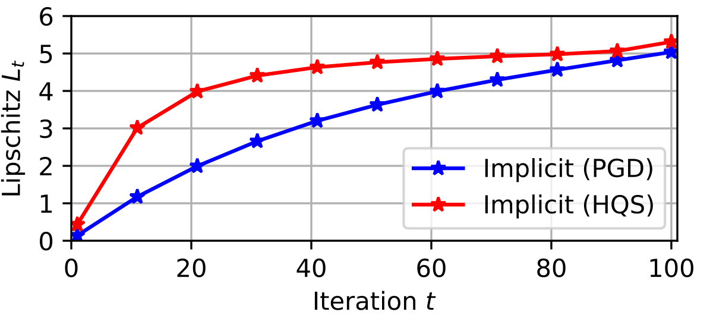{width=78% fig-align="left"}

Lipschitz of $\mathbf{y}_t(\cdot)$ grows with iterations
:::

::: {.column width="4%"}
<!-- empty -->
:::

::: {.column width="48%"}
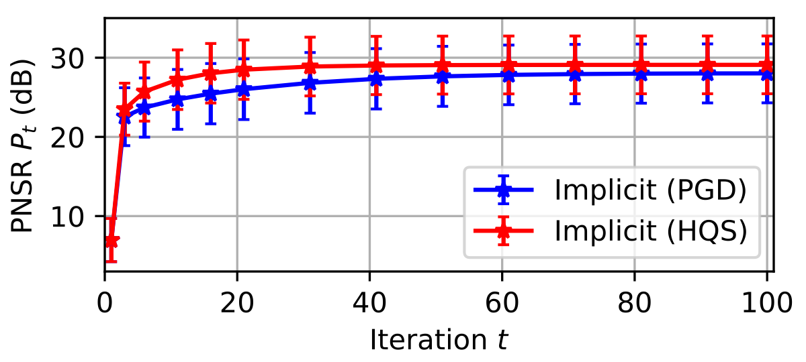{width=78% fig-align="left"}

PSNR rises and stabilizes
:::
::::

::: notes
(about 35 s) Here are the curves for deblurring. On the left, the measured Lipschitz constant of the t-step map keeps growing with iterations, as the theory predicts. On the right, the image quality rises and then stabilizes. The map gets steeper, and the answer gets better, at the same time.
:::

## Smaller Implicit Beats Larger Explicit

Linear programming: test error by GNN embedding size

| Model | Emb=4 | Emb=8 | Emb=16 | Emb=32 |
|-------|-------|-------|--------|--------|
| Explicit GNN | 0.397 | 0.273 | 0.283 | 0.318 |
| Implicit GNN | **0.218** | **0.177** | **0.152** | **0.156** |

Implicit-4 beats Explicit-8; explicit GNNs **overfit** at larger widths

::: notes
(about 35 s) For linear programming we can vary the size. The implicit network wins at every width. An implicit network of width four beats an explicit one of width eight. And look at the top row: the explicit networks get worse as they grow, they overfit, while the implicit ones stay flat.
:::

## Looped Language Model: Same Signature

::: {style="font-size: 0.8em;"}
| Iter | "Explain charge vs *voltage*" | "Explain charge vs *pay*" |
|------|---------------------------|----------------------|
| t=2 | (echoes input) | (echoes input) |
| t=6 | potential difference... | (still near prompt) |
| t=8 | **electric charge in a system** | **money that a person owes** |
:::

Model of @geiping2025scaling; Levenshtein sensitivity grows **29 → 53**

::: aside
Illustration only: tokens are discrete, so the Lipschitz theory does not strictly apply
:::

::: notes
(about 55 s) The fourth case is a looped language model, the recurrent-depth transformer of Geiping and coauthors. We give it two prompts that differ in one word: explain charge versus voltage, and explain charge versus pay. After two loops, both outputs just echo the prompt. After eight loops they have separated: one talks about electric charge, the other about money a person owes. Measured over two hundred such pairs, the sensitivity nearly doubles. I should be honest: tokens are discrete, so our theorems do not strictly apply here. It is an illustration. But it is the same signature.

Reference: Levenshtein-based sensitivity, geometric mean about 29.2 at t=2, saturating at about 52.5 by t=16.
:::

# Implications

::: notes
(about 5 s) What does this mean for how we build and analyze looped models? Two provocations.
:::

## Stability at a Price

**Our theory:** a *uniform* contraction bound $\mu(\mathbf{x}) \le \bar\mu < 1$ forces $\mathbf{y}_*(\cdot)$ to be globally Lipschitz: back to "simple"

. . .

**Yet uniform bounds are the standard route to stability:**

::: {style="font-size: 0.85em;"}
- Implicit models: well-posedness conditions [@el2021implicit], monotone operators [@winston2020monotone]
- Looped transformers: contraction conditions [@movahedi2026fixed], spectral constraints [@prairie2026parcae]
:::

. . .

::: {.callout-warning appearance="minimal"}
**Open:** training that guarantees *input-dependent* contraction
:::

::: notes
(about 70 s) The first is about stability. If you force the contraction modulus to be uniformly below one, our necessity argument gives you a globally Lipschitz fixed-point map. You are back in the simple class, and you have given up the advantage that iteration buys. Yet uniform bounds are exactly how stability is guaranteed in practice. In implicit models: well-posedness conditions and monotone operator parameterizations. In looped transformers this year: contraction conditions on the residual branch, and spectral constraints on input injection. These methods work well, and I do not think that contradicts us; the tasks may not need steep maps. But it does mean stability is being bought at a price that nobody has measured. What we lack is a training method that guarantees contraction that depends on the input.

The 'not a contradiction' reading is my view, not a theorem. The known generalization bound for implicit networks also assumes uniform contractivity.
:::

## Two Theories of "More Iterations"

::: {style="font-size: 0.72em;"}
| | Implicit models (this talk) | Looped transformers |
|---|---|---|
| Object | fixed-point map | finite-loop map of a given block |
| Result | exact function class | constructions with size and loop bounds |
| More iterations | approach a steeper limit | more program steps, more circuit depth |
| Convergence | essential | not required |
:::

::: {style="font-size: 0.64em;"}
Looped side: programmable computers [@giannou2023looped]; $\log n$ loops for $n$-fold composition [@saunshi2025reasoning]; loops $=$ threshold-circuit depth [@xu2025cot]; approximation rate in loops [@xu2024expressive]
:::

::: notes
(about 80 s) The second is about theory. There are now two theories of what more iterations means, and they have not met. Ours characterizes the fixed-point map and gives an exact function class; convergence is essential. Looped-transformer theory studies the map after a finite number of loops of a specific block, and gives constructions with explicit sizes; convergence is not required. There, a loop is a step of a program: a looped transformer can emulate a general-purpose computer. Or a loop is a unit of circuit depth: log n loops compose n elements, and loop count matches threshold-circuit depth exactly. The closest result to ours is by Xu and Sato, who bound approximation error by moduli of continuity, with a rate in the number of loops. They have a rate and a size bound. We have an exact class and a converse. Nobody yet has both.
:::

## Where the Two Already Meet

::: {style="font-size: 0.85em;"}
- **Input injection** is necessary for input-dependent fixed points [@labovich2026stability]

- **Fixed-point residual** as the halting rule in looped reasoners [@movahedi2026fixed; @huang2026equilibrium]

- **Path independence** predicts gains from extra test-time iterations [@anil2022path]
:::

. . .

::: {.callout-note appearance="minimal"}
Regular operators have all three **by construction**
:::

::: notes
(about 50 s) The two views do already touch in three places. Input injection: without it, a looped transformer's fixed points do not depend on the input in the convergent regime. The fixed-point residual: recent looped reasoners use it to decide when to stop, so compute adapts to difficulty. And path independence, meaning the answer does not depend on the starting point, which predicts whether extra test-time iterations help. Regular operators have all three by construction.
:::

## What We Know, and What Is Open

::: {style="font-size: 0.82em;"}
**Known:** simple $G$ + iteration $=$ exactly the locally Lipschitz maps
:::

. . .

::: {style="font-size: 0.82em;"}
**Open:**

1. **Rates:** how fast does expressivity grow with $t$?

2. **Size:** can a bounded-size block realize a regular operator for a steep target?

3. **Training:** how to guarantee input-dependent contraction?

4. **Beyond unique fixed points:** multiple equilibria [@jore2026bifurcation], cycles
:::

. . .

::: {.callout-tip appearance="simple"}
Iteration is a resource with its own **approximation theory**
:::

::: notes
(about 70 s) Let me close. What we know: a simple operator plus iteration gives exactly the locally Lipschitz maps. That is a function-space formalization of what looping can do. What is open? First, rates: how fast does expressivity grow with the number of loops? Second, size: can a block of bounded size realize a regular operator for a steep target? Third, training: how do we guarantee input-dependent contraction? And fourth, what happens beyond unique fixed points, with several equilibria or cycles, which trained looped models do show. Iteration is a resource, like width and depth, and it deserves its own approximation theory. Rates, sizes, step sizes, convergence: these are questions this community knows how to answer.

The open problems are my framing, except training to regularity, which the paper states as open.
:::

## Thank You

::: {style="text-align: center; font-size: 1.5em; margin-top: 2em;"}
**Questions?**
:::

::: {style="text-align: center; font-size: 0.8em; margin-top: 2em;"}
arXiv:2510.03638
:::

::: notes
(about 10 s) Thank you. I am happy to take questions.
:::

## Backup Slides

::: notes
Backup section begins.
:::

## Proof Sketch: Necessity

**Key observation:** fixed-point equation $\mathbf{y}_* = G(\mathbf{y}_*, \mathbf{x})$

. . .

Local Lipschitz of $\mathbf{y}_*$ bounded by:

$$\text{Lip}(\mathbf{y}_*) \lesssim \frac{\text{Lip}(G \text{ in } \mathbf{x})}{1 - \mu(\mathbf{x})}$$

where $\mu(\mathbf{x})$ is the contraction modulus

. . .

Blowup in $\mathbf{y}_*$ requires $\mu(\mathbf{x}) \to 1$ (slowing convergence)

::: notes
Sketch of necessity proof. A cover by overlapping cubes patches local results into a global one.
:::

## Finite Iterates Stay Simple {.scrollable}

::: {style="font-size: 0.85em;"}
**Claim (verify):** for regular $G$ on bounded $X$, every $\mathbf{y}_t$ is globally Lipschitz

$$\|\mathbf{y}_{t+1}(\mathbf{x}) - \mathbf{y}_{t+1}(\mathbf{x}')\| \le \mu(\mathbf{x})\,\|\mathbf{y}_t(\mathbf{x}) - \mathbf{y}_t(\mathbf{x}')\| + \big(a + b\,\|\mathbf{y}_t(\mathbf{x}')\|\big)\,\|\mathbf{x} - \mathbf{x}'\|$$

$$L_{t+1} \;\le\; L_t + a + b\,\sup_X \|\mathbf{y}_t\|$$

The Lipschitz budget grows step by step; the non-globally-Lipschitz class is reached only in the limit
:::

::: notes
Interpretation, to verify: a short induction, not a statement in the paper. y_t is bounded on bounded X because it is Lipschitz there. For 1/x this gives the exact value eta^2 t(t-1)/2.
:::

## Navier-Stokes Results

::: {layout-ncol=2}
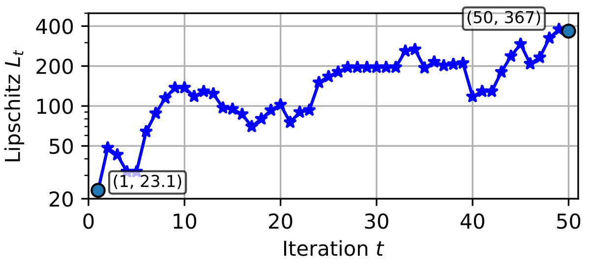{width=70% fig-align="left"}

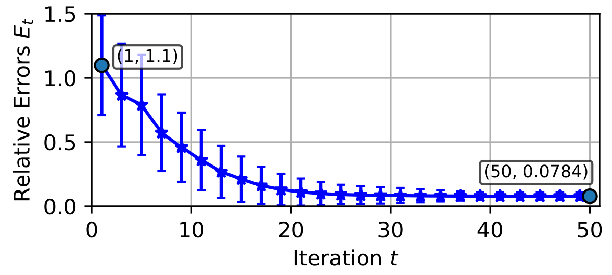{width=70% fig-align="left"}
:::

Same pattern: complexity grows, accuracy improves

::: notes
NS results match the theory.
:::

## Navier-Stokes: Visual Comparison

::: {layout-ncol=5}
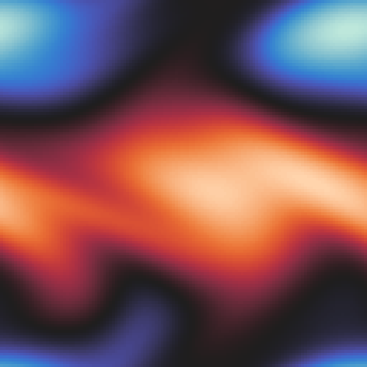

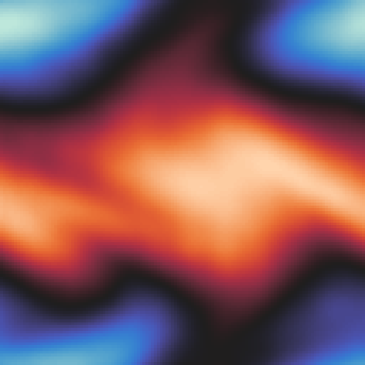

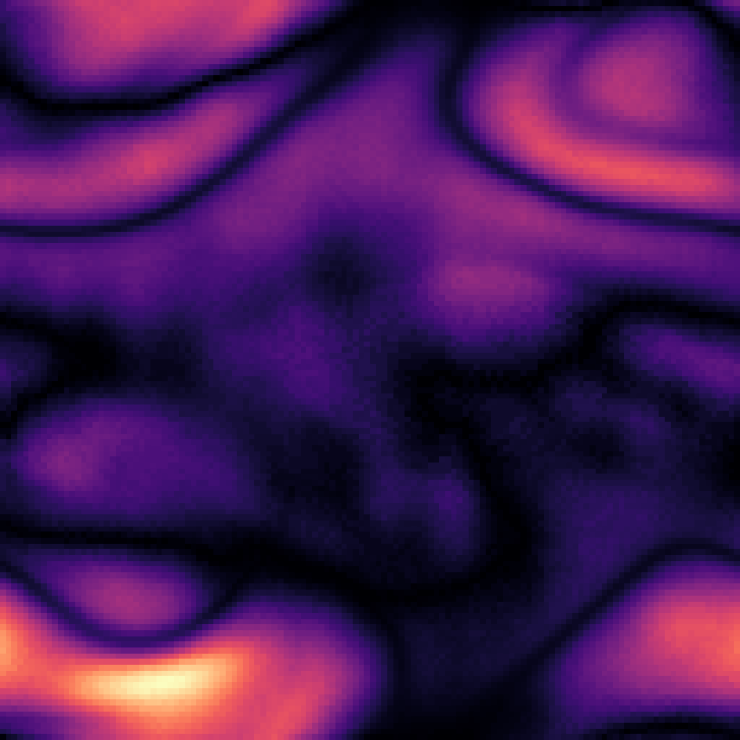

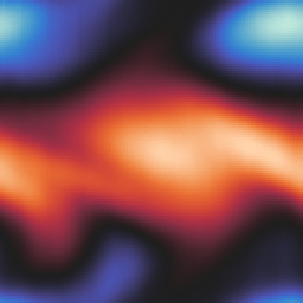

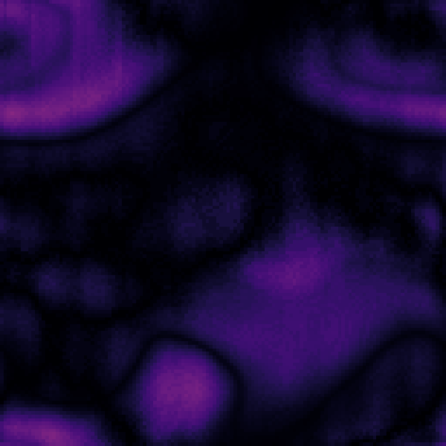
:::

Test average: 0.179 vs 0.078, same 2.376 M parameters

::: notes
Errors on the images are for this sample; the averages are over the test set.
:::

## LP Results

::: {layout-ncol=2}
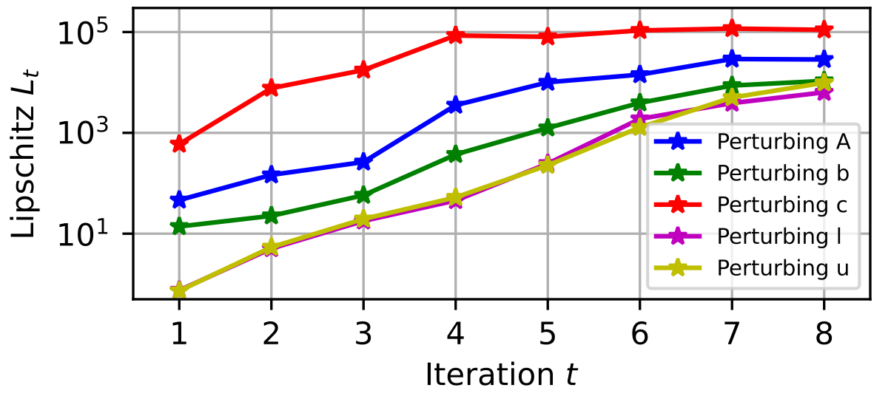{width=80% fig-align="left"}

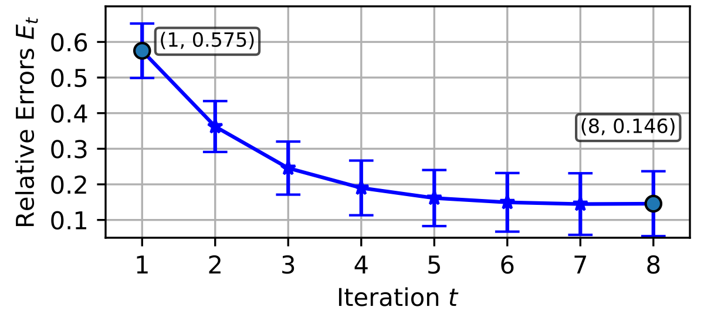{width=80% fig-align="left"}
:::

::: notes
LP Lipschitz and accuracy results.
:::

## Looped Transformers: Theorem Sheet {.scrollable}

::: {style="font-size: 0.66em;"}
- **Programmable computers** [@giannou2023looped]: a looped transformer with fewer than 13 layers executes $T$ program instructions in $T$ passes

- **Latent thoughts** [@saunshi2025reasoning]: a 1-layer block looped $\lceil \log_2 n\rceil$ times composes $n$ group elements; $m$ loops simulate $m$ chain-of-thought steps

- **Loops as depth** [@xu2025cot]: $T(n)$ loops $=$ threshold circuits of depth $T(n)$ (log precision, polynomial size)

- **Approximation rate** [@xu2024expressive]: error bounded by moduli of continuity at a scale set by the number of loops; exact memorization needs timestep encoding

- **Learning** [@gatmiry2024can]: minimizers with $L$ loops implement $L$-step preconditioned gradient descent in-context

- **Length generalization** [@fan2024looped]: scale loops with input length
:::

::: notes
Statements as given in the cited papers; proofs not verified by us.
:::

## Multiple Equilibria

::: {style="font-size: 0.85em;"}
**Bifurcation Models** [@jore2026bifurcation]

- Dynamics globally Lipschitz in $\mathbf{x}$
- Attractors: a finite set of locally Lipschitz **branches**
- Almost every initialization converges to a valid branch

**Equilibrium Reasoners** [@huang2026equilibrium]

- Scale in **depth** (iterations) and **breadth** (initializations)

Looped language models may also settle into **cycles** [@blayney2026mechanistic]
:::

::: notes
Uniqueness is relaxed in two directions: set-valued theory, and empirical use of many attractors. Path independence treats initialization dependence as a defect; breadth scaling treats it as a resource. Not yet reconciled.
:::

## Is a DEQ Just a Shallow Network?

@ling2024deep: at random initialization, on high-dimensional Gaussian mixtures, a DEQ's kernels match those of a shallow explicit network

. . .

**Compatible with our result:**

- Our notion of expressivity is not the static, linear-kernel one
- Their setting is *uniformly* contractive: the regime where we predict no advantage (interpretation)

::: notes
A likely question. Also expect: the separation result of Wu et al. (NeurIPS 2024), which is parametric and concerns steep functions.
:::

## Generalization Discussion

**Q: Does a large Lipschitz constant hurt generalization?**

. . .

**A:** The sensitivity is *inherent to the target* $F$, not the representation

- Any faithful model must track $F$'s sharp variations
- Implicit formulation regularizes via the *simple* operator $G$

. . .

Known bound for implicit networks [@fung2024generalization] assumes uniform contractivity

::: notes
Address generalization concerns. No bound yet covers the expressive regime where the modulus approaches 1.
:::

## Training Strategies {.scrollable}

::: {style="font-size: 0.9em;"}
**Unrolling:** Minimize $\ell(\mathbf{y}_T, \mathbf{y}_*)$ for fixed $T$ iterations [@geng2021training]

- Simple to implement
- Memory grows with $T$

**Implicit differentiation (DEQ):** [@bai2019deep]

- Differentiate fixed-point condition via implicit function theorem
- Constant memory, but requires solving linear system

**Jacobian-free backprop:** [@fung2022jfb]

- Only differentiate through last iteration
- Constant memory + simpler implementation
:::

::: notes
Training approaches for implicit models. Regularity is not enforced in the loss in our experiments.
:::

## References

::: {style="font-size: 0.8em;"}
::: {#refs}
:::
:::
